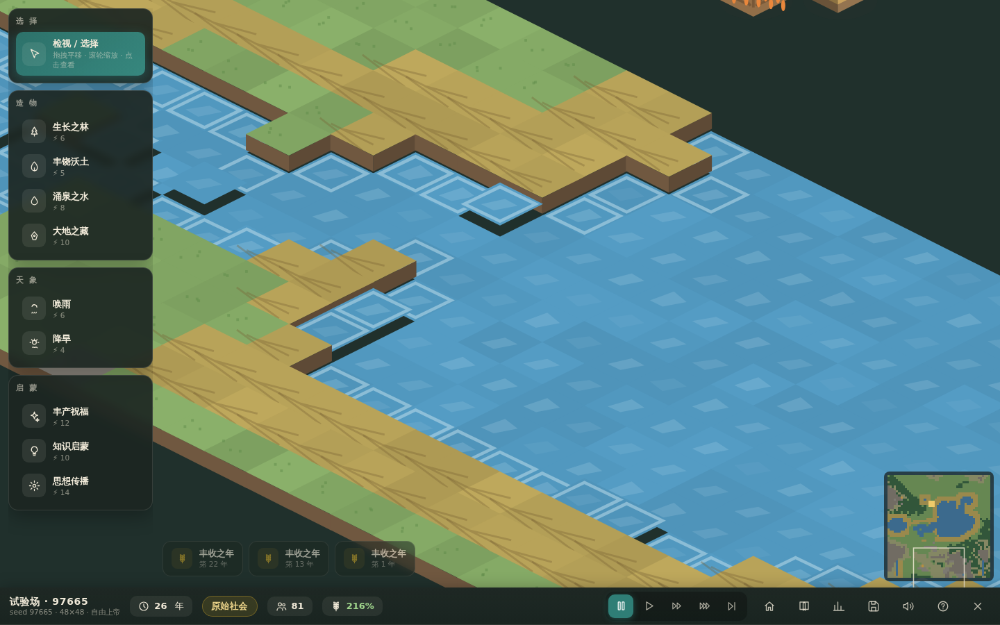

# Society Lab《人类社会实验室》

> 上帝视角的社会演化沙盒 · OhMyGame web-game 工程 · TypeScript + Canvas 2D · **零运行时依赖**
> **v2.0 · 历史进程大改版**——聚落会长大、名字会演进、社会形态有硬性前置、天灾有真实的画面表现

创造一个世界，看文明从部落生长为城市、从原始平等演化为各种社会形态——在关键的时刻，以神力改写历史的走向。



## 这是什么

一款融合上帝视角世界创造、文明演化、社会制度模拟、动态城市建设与历史叙事的单机沙盒游戏。玩家不是国王或总统，而是这个世界的神：可以观察文明按相互联系的规则自主发展，也可以通过改变地形、天象、资源、知识与思想来干预历史。

- **好玩**：17 种神力（造物/天象/灾厄/启蒙四组）、饥荒/瘟疫/战争/陨星风险、干预或旁观的选择、意料之外的结果（革命、分裂、倒退、复兴）。
- **好看**：方形全景取景框、精细化的居民（草帽/兜帽/高冠按职业区分）、三态树冠、时代建筑（神庙/庄园/城堡/学堂/银行/剧场/医院）、山洪/风暴/野火/陨星的真实特效、编年史事件卡。
- **可信**：人口、生产、所有制、分配、制度与冲突之间有可解释的因果链；**社会形态判定带硬性前置**——没有农业剩余与国家机器就不会有奴隶制，没有工业与城市就不会有资本主义。
- **耐玩**：种子复现实验、双初始情景、双神力模式、历史分支对照、64/96/128 三档地图。

## 快速开始

需要 Node.js 20+。

```sh
npm install
npm run dev        # 打开 http://127.0.0.1:5183
```

或直接游玩已构建版本（无需安装）：

```sh
npm run build      # 输出到 dist/（部署基座 /game/）
npx vite preview   # 或用任意静态服务器服务 dist/ 目录
```

其他命令：

```sh
npm test           # 模拟内核回归测试（13 项）
npx tsc --noEmit   # 类型检查
npx tsx tests/debug-longrun.ts       # 长跑平衡验证（1200 年演化时间线）
npx tsx tests/debug-institutions.ts  # 制度变量百年演化诊断
```

## 操作指南

| 操作 | 方式 |
| --- | --- |
| 移动视角 | 鼠标拖拽 |
| 缩放 | 滚轮（全景~2.8×，下限随地图自适应） |
| 暂停/继续 | `空格` 或顶栏按钮 |
| 调速 | `1` / `2` / `3` / `4`（正常/快速/极速/8×） |
| 单步推进 | 暂停时点 ⏭ 按钮 |
| 全景（看整张地图） | `H` 或 🏠 按钮 |
| 聚焦聚落 | `F`（最大聚落）/ 点击聚落后「聚焦」 |
| 收起/展开神力栏 | `Tab` 或栏顶部箭头 |
| 选择神力 | 左侧工具栏点击 → 地图上点击施放 |
| 取消神力 | `Esc` 或右键 |
| 笔刷大小 | 左栏「小/中/大」 |
| 编年史 / 观察者 / 存档 | `C` / `O` / `S` |
| 检视聚落 | 检视模式点击聚落（人口/住房/粮储/建筑/危机） |
| 小地图跳转 | 点击右下角小地图 |

游戏主画布为**方形取景框**，开局自动缩放到整张沙盘可见。

### 神力一览（17 种）

| 分组 | 神力 | 效果 | 能量 |
| --- | --- | --- | --- |
| 造物 | 生长之林 | 荒地长出森林 | 6 |
| 造物 | 丰饶沃土 | 土地肥沃化 | 5 |
| 造物 | 辽阔草原 | 荒芜化为宜居草原 | 4 |
| 造物 | 涌泉之水 | 旱地唤出水源 | 8 |
| 造物 | 大地之藏 | 埋下矿脉 | 10 |
| 造物 | 平地起山 | 大地隆起成丘陵山岳（可填水造陆） | 9 |
| 天象 | 唤雨 | 区域 5 年多雨（产量↑+雨幕特效） | 6 |
| 天象 | 降旱 | 区域 5 年干旱（产量↓+旱象） | 4 |
| 灾厄 | 陨星天坠 | 陨星轰击：焦土巨坑+建筑尽毁+冲击波特效 | 16 |
| 灾厄 | 风暴肆虐 | 区域风暴：摧毁农田与在建，乌云+斜雨+闪电 | 10 |
| 灾厄 | 燎原野火 | 焚毁森林与田垄，火舌+浓烟特效 | 8 |
| 灾厄 | 瘟疫降临 | 对最近聚落投放高致命疫病（绿色瘴气） | 14 |
| 启蒙 | 丰产祝福 | 聚落 6 年收成 +40%（金光环绕） | 12 |
| 启蒙 | 知识启蒙 | 注入知识点与启蒙思潮 | 10 |
| 启蒙 | 思想传播 | 提升 participation / 组织力 / 平民思想 | 14 |
| 启蒙 | 治愈之光 | 涤净全部疫病 + 4 年康健（光柱特效） | 12 |
| 启蒙 | 奠基之柱 | 引导移民在指定之地建立新聚落 | 18 |
| 响应 | 净化疫病 | 终止进行中的疫情（事件卡内触发） | 12 |

**自由上帝模式**神力无限；**有限干预模式**能量 100、每年恢复 4，需要权衡时机。所有神力都会写入编年史「神迹」条目。

### 社会如何演化（v2.0 历史进程）

模拟完全由变量驱动（没有"年份到了就升级"的设定），且**历史不会跳级**——每种社会形态都有硬性前置（点顶栏徽章可查看欠缺条件）：

- 采集 → 农耕：人口压力 + 农耕技术 ≥ 2 级（神力启蒙可加速）
- **聚落会长大**：部落（营地）→ 村落 → 村庄 → 城镇 → 城市，名字随之演进（河阳部落 → 河阳村 → 河阳镇 → 河阳城）
- 人口压力优先流入既有聚落（城市化），而非无限分裂小部落
- 战争（资源压力/领地毗邻）→ 俘虏 → 强制劳动 → **奴隶制**（需农耕 4 级 + 农业剩余 + 国家机器 + 村庄规模）
- 农业剩余 → 财富积累 → 土地集中 + 庄园 + 依附劳动 → **封建**（需农耕 5 级 + 城镇）
- 商贸 + 城市化 → 市场 → 工业（需工具 5 级 + 营造 4 级 + 商贸 3 级 + 文教 3 级）→ 雇佣劳动 → **资本主义**
- 文教 + 公共服务 + 政治参与 + 公有意识 → **社会主义**（需工业 4 级 + 城镇基础）
- 时代建筑随社会出现：神庙（早期国家）→ 庄园/城堡（封建）→ 学堂/工坊/集市（城镇）→ 工厂/银行/剧场（资本主义）→ 医院/合作社/公共堂（现代公共部门）
- 住宅随聚落升级：窝棚 → 农舍 → 街屋（城镇会逐步改建旧居所）
- 混合形态会显示"（某形态倾向）"；人口清零则成为**文明废墟**

典型时间线（96×96 河谷情景）：原始社会数百年 → 奴隶制/封建（约 400–800 年，视种子与地缘而定）→ 资本主义（约 700+ 年）。洪荒初民情景是慢速开局（千年级）。

不同的种子、地形、神力与随机事件组合会产生不同的历史路径——有的世界先入奴隶制，有的直入封建。用存档面板的「分支节点」可以从任意里程碑创建平行世界，对照两条历史。

## 存档说明

- **自动存档**：每 10 年写入 localStorage（主菜单可继续）。
- **手动槽位**：6 个；存档面板（`S`）点击空槽即存，点「读取」载入。
- **文件**：支持导出 JSON / 导入。
- **历史分支**：每 25 年与形态变迁年自动记录快照；也可手动「在此记录分支节点」，从带 ◆ 标记的节点创建新分支。
- 存档版本 `society-lab-save-v2`。

## 核心模块一览

| 模块 | 文件 | 职责 |
| --- | --- | --- |
| WorldGenerator | `src/worldgen.ts` | 种子化值噪声地形：山地/丘陵/河流/湖泊/沃土/森林/石地/矿脉 |
| SimulationManager | `src/sim/manager.ts` | 年度编排（天气→技术→经济→人口→建造→制度→形态→冲突→事件→快照）+ 形态判定回滞 |
| PopulationSystem | `src/sim/population.ts` | 出生/死亡/饥荒/迁徙（优先流入既有聚落）/受限分蘖 |
| EconomySystem | `src/sim/economy.ts` | 生产（劳动×土地×技术×天气×祝福）、消耗、资源、需求驱动建造 AI（时代建筑/住宅升级） |
| TechnologySystem | `src/sim/technology.ts` | 八域知识积累（人口边际递减 + 城市引擎 + 饱和阻尼）+ 跨域前置链 |
| InstitutionSystem | `src/sim/institutions.ts` | 所有制/劳动关系/土地集中/财富分配/信任漂移（建筑为制度物质载体） |
| SocietyClassifier | `src/sim/society.ts` | 五形态评分 + **硬性前置门控** + 未达条件清单 |
| ConflictSystem | `src/sim/conflict.ts` | 紧张度 → 抗议/改革/镇压/暴动/革命/分立 |
| EventSystem | `src/sim/events.ts` | 条件触发 + 真实原因记录 + 状态回写 + 治世/移民潮等 |
| GodPowerSystem | `src/powers.ts` | 17 种神力与能量经济（含陨星/风暴/野火/瘟疫/治愈/奠基） |
| VisualWorld | `src/render/` | 等距渲染、**静态地形缓存**、摄像机（全景适配）、居民网格寻路、事件特效系统、防重叠标签 |
| UIManager | `src/ui/` | HUD/事件卡/编年史/观察者/存档面板（可收缩工具栏） |
| SaveManager | `src/saves.ts` | 版本化 JSON、槽位、导入导出、分支 |
| AudioManager | `src/audio.ts` | Web Audio 全合成音效与环境（无音频文件） |

模拟内核（`src/sim/`）不依赖渲染与 DOM，全部参数集中在 `src/config.ts`。
模型假设详见 `canvas/documents/society-lab-model.md`。

## 测试与验证

- `npm test`：13 项模拟内核回归——种子确定性、世界生成合法性、五形态识别（硬前置）、饥荒触发、强制劳动→精英份额、神力实效、存档往返、长程 200 年不崩溃、形态变迁记录判定依据、**部落世界无法跳级识别为高级形态**。
- `npx tsx tests/debug-longrun.ts`：1200 年长跑时间线（河谷/洪荒双情景）。
- 无头浏览器实测（Chromium）：主菜单建图 → 全景视角 → 8× 快进 700 年 → 神力（陨星/风暴）→ 事件卡 → 编年史 → 观察者 → 存读档往返。开发模式暴露 `window.__OHMYGAME_PLAYTEST__`（snapshot/setSeed/step/usePower/serialize/loadSave）供自动化验证，生产构建不含。

## 部署说明

游戏构建产物以 `/game/` 为基座（`vite.config.ts` 的 `base: '/game/'`）：

- **Z.ai 沙箱**：`/home/z/my-project` 是标准 Next.js 16 工程，`public/game/` 内是游戏静态构建；根路由通过 `next.config.ts` 的 beforeFiles rewrite 直接服务游戏。发布 = `bun run build`（standalone 输出）。
- **任意静态服务器**：把 `dist/` 挂载到 `/game/` 路径即可。

## 已知限制

- 单文明（多聚落），无跨文明外交/贸易网络模拟。
- 事件文案为结构化模板生成，未接入 LLM 叙事。
- 音效为程序合成，音色简单。
- 奴隶制/封建路径需要战争驱动的地缘条件（资源压力或领地毗邻），部分和平世界会跳过这两阶段直入资本主义——这是路径依赖的有意设计。

## 环境说明

原设计提示词以 Godot 4.x 为首选；本项目按 OhMyGame 的 web-game 工程约定以 TypeScript + Canvas 2D 实现（零运行时依赖，可直接在任何现代浏览器运行），模块划分与设计目标与原提示词一致。设计文档工作区位于 `canvas/`（OhMyGame Design Canvas 文件契约）。

## License

Apache-2.0（见 `LICENSE`）。视觉与代码均为程序化生成，无第三方素材。
